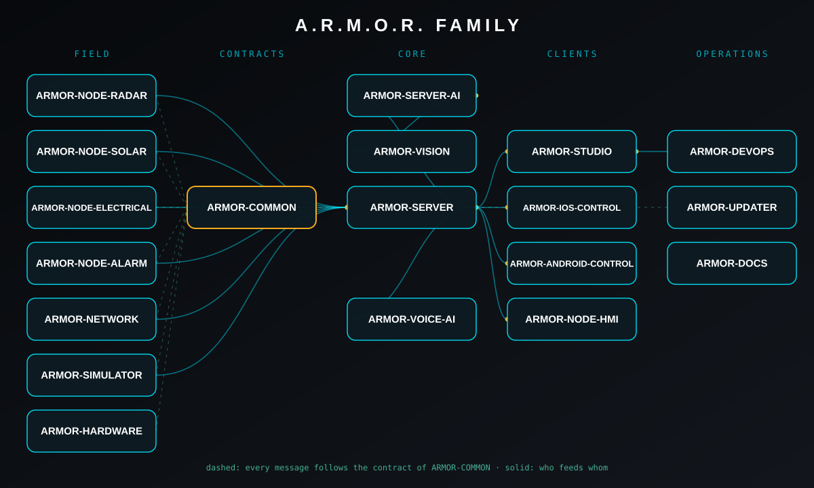

<p align="center">
  
</p>

# 📚 ARMOR-DOCS

<p align="center">
  <a href="README.md">🇺🇸 English</a> |
  <a href="README_spa.md">🇪🇸 Español</a> |
  🇫🇷 <b>Français</b> |
  <a href="README_ita.md">🇮🇹 Italiano</a> |
  <a href="README_deu.md">🇩🇪 Deutsch</a> |
  <a href="README_zho.md">🇨🇳 简体中文</a> |
  <a href="README_jpn.md">🇯🇵 日本語</a> |
  <a href="README_por.md">🇵🇹 Português</a>
</p>

### Architecture canonique, base de sécurité et vérité sur ce qui est prouvé

<p align="center">
  
  
  
  
  
</p>

---

**Vérification d'honnêteté - ce qui fonctionne aujourd'hui:** Ce dépôt documente des interfaces et des procédures qui ont été validées, et dit clairement ce qui ne l'a pas été. Lisez la [matrice de capacités](docs/CAPABILITY_MATRIX.md) avant de croire qu'une fonction est « faite » : elle dit pour chacune si elle a seulement été simulée, testée sur un ordinateur ou vérifiée sur du matériel réel. Les README des dix-huit dépôts sont écrits à partir d'une seule source (`tools/readme_src/`) en huit langues, la version et la maturité de chacun étant lues dans son propre manifeste, si bien qu'ils ne peuvent pas dire autre chose que le projet.

---

## 📋 En un coup d'œil

| | |
|---|---|
| Version | `0.8.1.2` |
| Maturité | Établi |
| Technologie | Markdown / Mermaid |
| Sur matériel réel | Sans objet : c'est de la documentation ; elle consigne ce que les autres dépôts ont fait tourner sur du matériel réel |

## 🚦 État du projet

Chaque ligne est une partie de ce dépôt et le feu dit où elle en est aujourd'hui. Elle est écrite d'après ce que le dépôt peut montrer (tests, compilations, exécutions), pas d'après ce qui est prévu.

🟢 Fait et vérifié · 🟡 Fonctionne, avec des limites connues · 🟠 À moitié fait ou pas encore vérifié · 🔴 Pas fait ou ne fonctionne pas

| Domaine | État | Ce que cela veut dire ici |
|---|---|---|
| Logiciel | 🟢 | Les générateurs de README, de bannières, de catalogue et de matrice de capacités, et les outils de CI copiés dans chaque dépôt, fonctionnent et sont testés. |
| Contrôles automatiques | 🟢 | Chaque push vérifie que les README, les bannières et le catalogue sont à jour et que chaque dépôt du registre a son tableau d'état. |
| Intégration | 🟢 | Les README de tous les dépôts sont écrits à partir d'une seule source, avec la version et la maturité de chacun lues dans son propre manifeste. |
| Documentation | 🟢 | La matrice de capacités dit, pour chaque fonction, si elle n'a été que simulée, testée sur un ordinateur ou vérifiée sur du matériel réel ; les huit langues et le journal des modifications sont à jour. |

## 🎯 Présentation

<p align="center">
  
</p>

* [Matrice de capacités](docs/CAPABILITY_MATRIX.md) : pour chaque capacité, est-elle simulée, testée sur un ordinateur ou vérifiée sur du matériel ?
* [Architecture](docs/ARCHITECTURE.md) : réseaux, frontières de confiance, temps et ordre.
* [Base de sécurité](docs/SECURITY_BASELINE.md) : la conception des VLAN, ce que le code impose et ce qui manque encore ; et le [modèle de menaces](docs/THREAT_MODEL.md).
* [Catalogue de projets](docs/PROJECT_CATALOG.md) : les dix-huit dépôts, leurs versions et leurs dépendances.
* [Interfaces](docs/INTERFACES.md) : qui produit et consomme chaque interface et où on lui fait confiance.
* [Première tranche verticale](docs/FIRST_VERTICAL_SLICE.md) : ce que prouve le test du simulateur à la console et ce qu'il ne prouve pas.
* **Outils :** `make_readmes.py` écrit le README de chaque dépôt dans les huit langues à partir de `readme_src/`, `make_catalog.py` écrit les versions du catalogue, `make_brand.py` sa bannière et son icône, `publication_check.py` cherche tout ce qui est privé avant une publication, `clean_history.py` fait une copie publiable d'un dépôt et `sync_ci_tools.py` garde égaux les contrôles de CI de la famille.

## 🧩 Rôle dans A.R.M.O.R.

ARMOR-DOCS est la mémoire de la famille : c'est là que vivent l'architecture, la base de sécurité et la matrice de capacités, et l'endroit qui dit, pour chaque dépôt, ce qui a vraiment tourné sur du matériel. Il garde aussi l'outil qui écrit les README des dix-huit dépôts à partir d'une seule source, pour que les huit langues ne dérivent pas.

## 📂 Structure du dépôt

```text
ARMOR-DOCS/
├── docs/     CAPABILITY_MATRIX, ARCHITECTURE, SECURITY_BASELINE, PROJECT_CATALOG, INTERFACES, THREAT_MODEL, FIRST_VERTICAL_SLICE
├── tools/    make_readmes.py (+ readme_src/: the facts and the words of every repository in eight languages), make_catalog.py, make_brand.py (+ brand_banner.py), registry.py (reads the list of repositories of ARMOR-COMMON), publication_check.py, clean_history.py, sync_ci_tools.py, check_all.sh
├── tests/    the tests of these tools: the publication check, the history cleaner, the README, catalogue and brand generators, the copy of the CI tools and the shared workflow tool
├── brand/    the emblem
└── images/   this repository's banner, icon and the family picture
```

## 🛠️ Environnement de développement

**Prérequis:** Python 3.11+ pour les outils

```bash
python tools/make_readmes.py --check      # the READMEs (8 languages) are current
python tools/make_catalog.py --check     # the versions and maturity of the catalogue are current
python tools/make_brand.py --check        # the banners and icons are current
python tools/publication_check.py         # nothing private would leave with a publication
bash tools/check_all.sh                   # every repository's own tests, in one run
python -m unittest discover -s tests     # the tests of these tools (they need no other repository)
```

## 🔗 Projets liés

**A.R.M.O.R.** (Autonomous Radar & Multimodal Observation Range) est un système de sécurité périmétrique composé de dépôts indépendants. Chacun a sa propre version, ses propres tests et son propre README ; voici la famille :

* **[ARMOR-COMMON](https://github.com/JuanenRac/ARMOR-COMMON)** - Contrats de messages, validateurs, vecteurs de conformité et types générés
* **[ARMOR-NODE-RADAR](https://github.com/JuanenRac/ARMOR-NODE-RADAR)** - Firmware du nœud de terrain pour ESP32-S3 avec trois radars et son propre panneau web
* **[ARMOR-NODE-SOLAR](https://github.com/JuanenRac/ARMOR-NODE-SOLAR)** - Protocoles des onduleurs et batteries solaires et messages d'un nœud passerelle
* **[ARMOR-NODE-ELECTRICAL](https://github.com/JuanenRac/ARMOR-NODE-ELECTRICAL)** - Nœud électrique : compteurs, le message des mesures du réseau et les règles de commutation
* **[ARMOR-NODE-ALARM](https://github.com/JuanenRac/ARMOR-NODE-ALARM)** - Nœud et centrale d'alarme : zones, armement, temporisations, sirène et PIN, avec ou sans le serveur
* **[ARMOR-NODE-HMI](https://github.com/JuanenRac/ARMOR-NODE-HMI)** - Panneau tactile : l'état du système sur un écran mural, armer et acquitter, et la maison de l'assistant vocal
* **[ARMOR-NETWORK](https://github.com/JuanenRac/ARMOR-NETWORK)** - Le réseau local : ses appareils, internet et ce qui change
* **[ARMOR-SERVER](https://github.com/JuanenRac/ARMOR-SERVER)** - Coordinateur central : télémétrie, alarmes, appareils, relevés solaires et caméras
* **[ARMOR-STUDIO](https://github.com/JuanenRac/ARMOR-STUDIO)** - Console web : caméras, radar, alarmes, énergie solaire et concepteur de site 2D/3D
* **[ARMOR-ANDROID-CONTROL](https://github.com/JuanenRac/ARMOR-ANDROID-CONTROL)** - Client Android de l'opérateur avec radar 2D/3D en direct
* **[ARMOR-IOS-CONTROL](https://github.com/JuanenRac/ARMOR-IOS-CONTROL)** - Client opérateur iPhone
* **[ARMOR-SERVER-AI](https://github.com/JuanenRac/ARMOR-SERVER-AI)** - Politique d'inférence visuelle qui explique ses décisions et n'agit jamais
* **[ARMOR-VISION](https://github.com/JuanenRac/ARMOR-VISION)** - Zones de caméra, masques et règles de détection pour la Jetson Orin NX
* **[ARMOR-VOICE-AI](https://github.com/JuanenRac/ARMOR-VOICE-AI)** - Intentions vocales hors ligne avec une confirmation impossible à falsifier
* **[ARMOR-HARDWARE](https://github.com/JuanenRac/ARMOR-HARDWARE)** - Boîtiers, électronique et matrice d'acceptation sur banc
* **[ARMOR-DEVOPS](https://github.com/JuanenRac/ARMOR-DEVOPS)** - Déploiement, banc d'essai CM5, sauvegarde et TLS
* **[ARMOR-SIMULATOR](https://github.com/JuanenRac/ARMOR-SIMULATOR)** - Simulateur de télémétrie hors ligne avec des pannes reproductibles
* **[ARMOR-UPDATER](https://github.com/JuanenRac/ARMOR-UPDATER)** - Détecte, installe et met à jour les propres dépôts de l'écosystème
* **ARMOR-DOCS** (ce dépôt) - Architecture, base de sécurité et matrice des capacités

## 📚 Documentation et communauté

Pour en savoir plus :

* [Matrice des capacités : ce qui est prouvé et ce qui ne l'est pas](docs/CAPABILITY_MATRIX.md)
* [Catalogue des projets : versions et dépendances entre les dépôts](docs/PROJECT_CATALOG.md)
* [Historique des modifications de ce dépôt](CHANGELOG.md)
* [Licence (GPL-3.0-or-later)](LICENSE)
* Questions, idées et rapports : electrohobby3d@gmail.com

## 👤 AUTEUR

**JuanenRac (Electro Hobby 3D)** · electrohobby3d@gmail.com

## 📜 LICENCE

GPL-3.0-or-later - voir [LICENSE](LICENSE).
