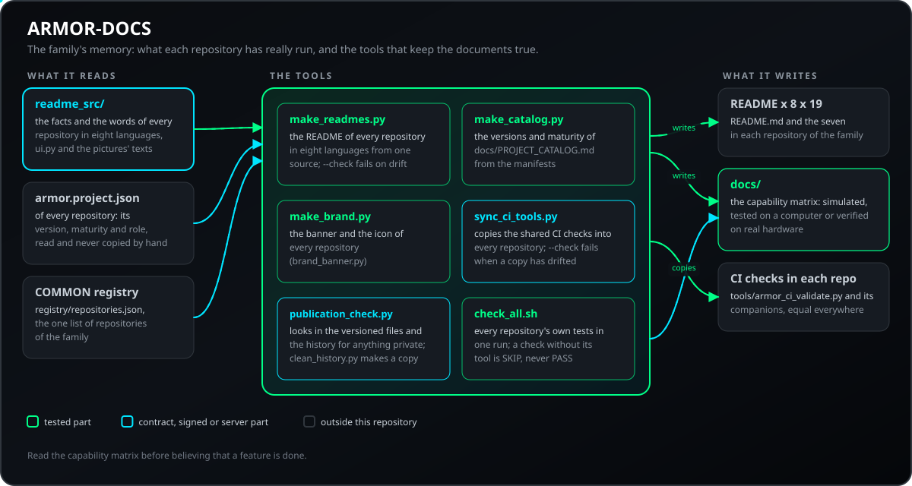
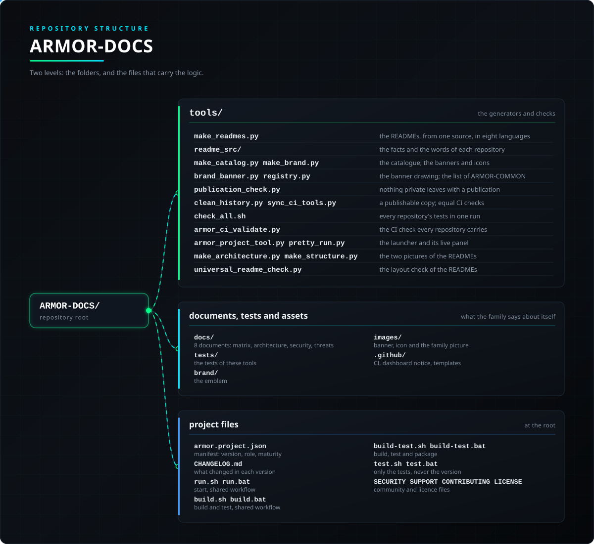

<p align="center">
  
</p>

# 📚 ARMOR-DOCS

<p align="center">
  <a href="README.md">🇺🇸 English</a> |
  <a href="README_spa.md">🇪🇸 Español</a> |
  <a href="README_fra.md">🇫🇷 Français</a> |
  <a href="README_ita.md">🇮🇹 Italiano</a> |
  <a href="README_deu.md">🇩🇪 Deutsch</a> |
  <a href="README_zho.md">🇨🇳 简体中文</a> |
  <a href="README_jpn.md">🇯🇵 日本語</a> |
  🇵🇹 <b>Português</b>
</p>

### Arquitetura canónica, linha de base de segurança e a verdade sobre o que está provado

<p align="center">
  
  
  
  
  
  
</p>

---

**Verificação de honestidade - o que funciona hoje:** Este repositório documenta interfaces e procedimentos que foram validados, e diz claramente o que não foi. Leia a [matriz de capacidades](docs/CAPABILITY_MATRIX.md) antes de acreditar que uma funcionalidade está "feita": diz de cada uma se foi apenas simulada, testada num computador ou verificada em hardware real. Os README dos dezanove repositórios são escritos a partir de uma única fonte (`tools/readme_src/`) em oito idiomas, com a versão e a maturidade de cada um lidas do seu próprio manifesto, pelo que não podem dizer algo diferente do projeto.

---

## 📋 Num relance

| | |
|---|---|
| Versão | `0.8.1.3` |
| Maturidade | Estabelecido |
| Função | Centro de documentação: arquitetura, base de segurança, matriz de capacidades e as ferramentas que escrevem os README, o catálogo e as faixas |
| Tecnologia | Python 3.11+ (ferramentas, biblioteca padrão), Markdown |
| Testes | 199 (`python -m unittest discover -s tests`, cerca de um minuto) |
| Interfaces | `make_readmes.py`, `make_catalog.py`, `make_brand.py`, `publication_check.py`, `clean_history.py`, `sync_ci_tools.py`, `check_all.sh` |
| Funciona em | Qualquer computador com Python; os repositórios da família ao lado deste |
| Em hardware real | Não se aplica: é documentação; regista o que os outros repositórios correram em hardware real |
| Licença | GPL-3.0-or-later |

**Ir para:** [Visão geral](#-visão-geral) · [Arquitetura](#-arquitetura) · [Segurança](#-segurança-e-proteção) · [Interfaces](#-interfaces) · [Início rápido](#-início-rápido) · [Testes](#-testes) · [Problemas](#-resolução-de-problemas) · [Estrutura](#-estrutura-do-repositório) · [Relacionados](#-projetos-relacionados)

## 🚦 Estado do projeto

Cada linha é uma parte deste repositório e a luz diz até onde chega hoje. É escrita com o que o repositório consegue demonstrar (testes, compilações, execuções), não com o que está previsto.

🟢 Feito e verificado · 🟡 Funciona, com limites conhecidos · 🟠 Feito a meio ou ainda por verificar · 🔴 Por fazer ou a não funcionar

| Área | Estado | O que significa aqui |
|---|---|---|
| Software | 🟢 | Os geradores de READMEs, faixas, catálogo e matriz de capacidades, e as ferramentas de CI copiadas para cada repositório, funcionam e estão testados. |
| Testes | 🟢 | Os 199 testes das ferramentas passam (`python -m unittest discover -s tests`): a verificação de publicação, o limpador de histórico, os geradores de README, catálogo e marca, a cópia das ferramentas de CI e a ferramenta do fluxo partilhado. |
| Verificações automáticas | 🟢 | Cada push verifica que os READMEs, as faixas e o catálogo estão atualizados e que cada repositório do registo tem a sua tabela de estado. |
| Integração | 🟢 | Os READMEs de todos os repositórios são escritos a partir de uma só fonte, com a versão e a maturidade de cada um lidas do seu próprio manifesto. |
| Documentação | 🟢 | A matriz de capacidades diz, para cada função, se foi apenas simulada, testada num computador ou verificada em hardware real; os oito idiomas e o registo de alterações estão atualizados. |

## 🎯 Visão geral

<p align="center">
  
</p>

* [Matriz de capacidades](docs/CAPABILITY_MATRIX.md): de cada capacidade, está simulada, testada num computador ou verificada em hardware?
* [Arquitetura](docs/ARCHITECTURE.md): redes, limites de confiança, tempo e ordem.
* [Base de segurança](docs/SECURITY_BASELINE.md): o desenho de VLAN, o que o código impõe e o que ainda falta; e o [modelo de ameaças](docs/THREAT_MODEL.md).
* [Catálogo de projetos](docs/PROJECT_CATALOG.md): os dezanove repositórios, as suas versões e como dependem uns dos outros.
* [Interfaces](docs/INTERFACES.md): quem produz e consome cada interface e onde se confia nela.
* [Primeira fatia vertical](docs/FIRST_VERTICAL_SLICE.md): o que o teste do simulador à consola prova e o que não prova.
* **Ferramentas:** `make_readmes.py` escreve o README de cada repositório nos oito idiomas a partir de `readme_src/`, `make_catalog.py` escreve as versões do catálogo, `make_brand.py` o seu banner e ícone, `publication_check.py` procura qualquer coisa privada antes de uma publicação, `clean_history.py` faz uma cópia publicável de um repositório e `sync_ci_tools.py` mantém iguais as verificações de CI da família, incluindo ruff e mypy (versões fixas, apenas onde um repositório tem configuração do mypy; `ci_lint = false` no pyproject.toml ignora-as).

## 🧩 Papel no A.R.M.O.R.

O ARMOR-DOCS é a memória da família: é onde vivem a arquitetura, a base de segurança e a matriz de capacidades, e o sítio que diz, de cada repositório, o que correu mesmo em hardware. Guarda também a ferramenta que escreve os README dos dezanove repositórios a partir de uma só fonte, para que os oito idiomas não se separem.

| Fala com | Como | Para quê |
|---|---|---|
| Cada repositório da família | o seu `armor.project.json` e os seus ficheiros README | as ferramentas leem a versão e a maturidade e escrevem o README, a faixa e as cópias de CI |
| ARMOR-COMMON | `registry/repositories.json` | a lista única dos repositórios da família, lida por `registry.py` |
| Quem publica | `publication_check.py`  `clean_history.py` | o que vazaria e uma cópia de um só commit que se pode publicar |

## 🏛️ Arquitetura

<p align="center">
  
</p>

## 🔒 Segurança e proteção

| Ameaça | Defesa |
|---|---|
| Publicar algo privado | `publication_check.py` só lê o git (ficheiros versionados e histórico, nunca os ignorados) e nunca imprime o segredo. BLOCK: uma chave privada, um IP público, um e-mail pessoal, um `secrets/` ou `.env` versionado, um commit com coautor ou linha de IA, um autor de commit diferente do do projeto; REVIEW: uma linha que parece uma palavra-passe ou token literal; sai com 1 perante qualquer BLOCK |
| Um histórico com restos | `clean_history.py` faz uma cópia publicável de um repositório com um só commit feito pelo autor do projeto |
| Afirmar mais do que foi provado | `docs/CAPABILITY_MATRIX.md` tem três níveis (Simulated, Local, Verified) mais None, Absent e Local-not-activated; só as linhas Verified tocaram em hardware (a bancada do CM5 em uso diário) |
| Um README que diz outra coisa do que o projeto | A versão e a maturidade de cada README são lidas do seu próprio manifesto; cada push verifica que os README, as faixas e o catálogo estão atualizados e que cada repositório do registo tem a sua tabela de estado |

Os documentos de segurança da família são [docs/SECURITY_BASELINE.md](docs/SECURITY_BASELINE.md) (o desenho das VLAN, o que o código impõe e o que ainda falta) e [docs/THREAT_MODEL.md](docs/THREAT_MODEL.md). Nada disto prova a ausência de um segredo.

## 🔌 Interfaces

| Rota | Autenticação | O que faz |
|---|---|---|
| `python tools/make_readmes.py [--check]` | - | escreve o README de cada repositório em oito idiomas a partir de `tools/readme_src/`; `--check` falha se algum estiver desatualizado. Reescreve todos os ficheiros: mude a fonte, nunca os README |
| `python tools/make_catalog.py [--check]`  `make_brand.py [--check]` | - | as versões e a maturidade de `docs/PROJECT_CATALOG.md`, e as faixas e os ícones |
| `python tools/publication_check.py [REPO] [--no-history] [--ref=BRANCH]` | - | o que vazaria se os repositórios fossem publicados; sai com 1 perante BLOCK |
| `python tools/clean_history.py` | - | uma cópia publicável de um repositório com um só commit |
| `python tools/sync_ci_tools.py [--check]` | - | copia as verificações de CI e o lançador para cada repositório; `--check` falha se uma cópia divergiu |
| `python tools/status_lights.py --check|--suggest|--apply` | - | mantém as luzes da tabela de estado do projeto abaixo do que o manifesto permite (maturidade e evidência); move luzes, nunca frases; a CI de cada repositório executa `--check` |
| `bash tools/check_all.sh [--android] [--compose]` | - | os testes de cada repositório numa execução; uma verificação sem a sua ferramenta é SKIP, nunca PASS |

A fonte de cada README é `tools/readme_src/repos/<REPOSITÓRIO>.py` (os factos que não dependem do idioma e as palavras dos oito idiomas), com `ui.py` para as palavras à volta de cada README e `shots.py` para as capturas. `tools/registry.py` lê a lista de repositórios do ARMOR-COMMON. Veja também [docs/INTERFACES.md](docs/INTERFACES.md) e [docs/SETUP_CODE.md](docs/SETUP_CODE.md).

## 🚀 Início rápido

**Requisitos:** Python 3.11+ para as ferramentas (só biblioteca padrão); os repositórios da família ao lado deste para as verificações que os leem.

```bash
python tools/make_readmes.py --check  # os README (8 idiomas) estão atualizados
python tools/make_catalog.py --check  # as versões e a maturidade do catálogo estão atualizadas
python tools/make_brand.py --check    # as faixas e os ícones estão atualizados
python tools/publication_check.py     # nada privado sairia com uma publicação
bash tools/check_all.sh               # os testes de cada repositório, numa execução
python -m unittest discover -s tests  # 199 testes destas ferramentas; não precisam de outro repositório
```

## 🧪 Testes

| Área | O que cobre |
|---|---|
| O gerador de README | os oito idiomas e as secções de cada repositório |
| Catálogo e marca | `test_make_catalog_and_brand.py`, `test_repository_registry.py` |
| Publicação | o que é BLOCK e REVIEW, e a cópia de um commit |
| Ferramentas de CI e lançador | `test_ci_validate.py`, `test_sync_ci_tools.py`, `test_project_tool.py`, `test_check_all_script.py` |

O GitHub Actions executa a base do A.R.M.O.R. em cada push e pull request: a validação do manifesto, da versão, do registo de alterações e da paridade dos README, e depois a compilação e os testes do próprio projeto.

## 🏗️ Compilação e publicação

Não há nada para compilar. A versão está em `armor.project.json` e no emblema do README (lido do manifesto); cada versão tem a sua entrada em [CHANGELOG.md](CHANGELOG.md). As versões são publicadas no GitHub.

## 🩺 Resolução de problemas

| Vê | Porque | Faça |
|---|---|---|
| `READMEs out of date:` + a list | mudou uma fonte de `tools/readme_src/` ou um manifesto e os README não foram reescritos | execute `python tools/make_readmes.py`, veja o que mudou em cada repositório e faça commit lá |
| `Status tables incomplete:` | um repositório do registo tem uma tabela de estado sem as linhas ou cores esperadas | complete `FACTS["status"]` e as notas na sua fonte |
| Uma verificação diz SKIP | falta a sua ferramenta ou o repositório ao lado deste; uma verificação sem a sua ferramenta nunca é PASS | instale a ferramenta ou clone o repositório ao lado deste |
| `publication_check.py` BLOCK | foi encontrado algo que não deve ficar público (ficheiro, linha e tipo, nunca o valor) | retire-o e use `clean_history.py` se estiver no histórico |

## 📂 Estrutura do repositório

<p align="center">
  
</p>

<details>
<summary>Versão em texto da árvore</summary>

```text
ARMOR-DOCS/
├── tools/
│   ├── make_readmes.py                          os README a partir de uma fonte, em oito idiomas
│   ├── readme_src/                              os factos e as palavras de cada repositório
│   ├── make_catalog.py make_brand.py            o catálogo; as faixas e os ícones
│   ├── brand_banner.py registry.py              o desenho da faixa; a lista do ARMOR-COMMON
│   ├── publication_check.py                     nada privado sai com uma publicação
│   ├── clean_history.py sync_ci_tools.py        uma cópia publicável; verificações de CI iguais
│   ├── check_all.sh                             os testes de cada repositório numa execução
│   ├── armor_ci_validate.py                     a verificação de CI de cada repositório
│   ├── armor_project_tool.py pretty_run.py      o lançador e o seu painel em direto
│   ├── make_architecture.py make_structure.py   as duas imagens dos README
│   └── universal_readme_check.py                a verificação do formato dos README
├── docs/                                        CAPABILITY_MATRIX, ARCHITECTURE, SECURITY_BASELINE, THREAT_MODEL, PROJECT_CATALOG, INTERFACES, FIRST_VERTICAL_SLICE, SETUP_CODE
├── tests/                                       os testes destas ferramentas
├── brand/                                       o emblema
├── images/                                      faixa, ícone, a imagem da família e as imagens deste README
├── .github/                                     fluxo de CI, aviso ao painel, modelos de issues e pull requests
├── armor.project.json                           manifesto: versão, função, maturidade
├── CHANGELOG.md                                 o que mudou em cada versão
├── run.sh run.bat                               arrancar, fluxo partilhado
├── build.sh build.bat                           compilar e testar, fluxo partilhado
├── build-test.sh build-test.bat                 compilar, testar e empacotar
├── test.sh test.bat                             só os testes, nunca a versão
└── SECURITY.md SUPPORT.md CONTRIBUTING.md CODE_OF_CONDUCT.md LICENSE
```

</details>

## 🗺️ Roteiro e limites conhecidos

**Limites conhecidos hoje**

* A matriz de capacidades é a verdade sobre o que correu: até uma linha dizer Verified, não tocou em hardware real.
* Só o nó de radar e a bancada do CM5 correram em hardware real.
* Sem revisão de segurança independente.

**A seguir**

* Passar linhas da matriz a Verified à medida que os outros nós correm nas suas placas.

## 🌍 Idiomas

O README e os textos existem em inglês, espanhol, francês, italiano, alemão, chinês, japonês e português europeu.

## 🔗 Projetos relacionados

O **A.R.M.O.R.** (Autonomous Radar & Multimodal Observation Range) é um sistema de segurança perimetral feito de repositórios independentes. Cada um tem a sua própria versão, os seus próprios testes e o seu próprio README; esta é a família:

* **[ARMOR-COMMON](https://github.com/JuanenRac/ARMOR-COMMON)** - Contratos de mensagens, validadores, vetores de conformidade e tipos gerados
* **[ARMOR-NODE-RADAR](https://github.com/JuanenRac/ARMOR-NODE-RADAR)** - Firmware de nó de campo para ESP32-S3 com três radares e o seu próprio painel web
* **[ARMOR-NODE-SOLAR](https://github.com/JuanenRac/ARMOR-NODE-SOLAR)** - Protocolos de inversores e baterias solares e as mensagens de um nó porta de ligação
* **[ARMOR-NODE-ELECTRICAL](https://github.com/JuanenRac/ARMOR-NODE-ELECTRICAL)** - Nó elétrico: contadores, a mensagem das leituras da rede e as regras de comutação
* **[ARMOR-NODE-ALARM](https://github.com/JuanenRac/ARMOR-NODE-ALARM)** - Nó e painel de alarme: zonas, armar, atrasos, sirene e PIN, com o servidor ou sem ele
* **[ARMOR-NODE-HMI](https://github.com/JuanenRac/ARMOR-NODE-HMI)** - Painel tátil: o estado do sistema num ecrã de parede, armar e reconhecer, e a casa do assistente de voz
* **[ARMOR-NETWORK](https://github.com/JuanenRac/ARMOR-NETWORK)** - A rede local: os seus dispositivos, a internet e o que muda
* **[ARMOR-SERVER](https://github.com/JuanenRac/ARMOR-SERVER)** - Coordenador central: telemetria, alarmes, dispositivos, leituras solares e câmaras
* **[ARMOR-STUDIO](https://github.com/JuanenRac/ARMOR-STUDIO)** - Consola web: câmaras, radar, alarmes, energia solar e o desenhador 2D/3D do local
* **[ARMOR-ANDROID-CONTROL](https://github.com/JuanenRac/ARMOR-ANDROID-CONTROL)** - Cliente de operador Android com radar 2D/3D em direto
* **[ARMOR-IOS-CONTROL](https://github.com/JuanenRac/ARMOR-IOS-CONTROL)** - Cliente de operador para iPhone
* **[ARMOR-SERVER-AI](https://github.com/JuanenRac/ARMOR-SERVER-AI)** - Política de inferência visual que explica as suas decisões e nunca atua
* **[ARMOR-VISION](https://github.com/JuanenRac/ARMOR-VISION)** - Zonas de câmara, máscaras e regras de deteção para o Jetson Orin NX
* **[ARMOR-VOICE-AI](https://github.com/JuanenRac/ARMOR-VOICE-AI)** - Intenções de voz offline com uma confirmação que não pode ser falsificada
* **[ARMOR-HARDWARE](https://github.com/JuanenRac/ARMOR-HARDWARE)** - Caixas, eletrónica e a matriz de aceitação em bancada
* **[ARMOR-DEVOPS](https://github.com/JuanenRac/ARMOR-DEVOPS)** - Implantação, a bancada de testes do CM5, cópias de segurança e TLS
* **[ARMOR-SIMULATOR](https://github.com/JuanenRac/ARMOR-SIMULATOR)** - Simulador de telemetria offline com falhas repetíveis
* **[ARMOR-UPDATER](https://github.com/JuanenRac/ARMOR-UPDATER)** - Deteta, instala e atualiza os repositórios do próprio ecossistema
* **ARMOR-DOCS** (este repositório) - Arquitetura, base de segurança e a matriz de capacidades

## 📚 Documentação

* [ARCHITECTURE](docs/ARCHITECTURE.md): redes, fronteiras de confiança, tempo e ordenação
* [SECURITY_BASELINE](docs/SECURITY_BASELINE.md): o desenho das VLAN, o que o código impõe e o que falta
* [THREAT_MODEL](docs/THREAT_MODEL.md): contra o que se defende e contra o que não
* [INTERFACES](docs/INTERFACES.md): quem produz e consome cada interface e onde se confia nela
* [FIRST_VERTICAL_SLICE](docs/FIRST_VERTICAL_SLICE.md): o que prova o teste do simulador à consola e o que não prova
* [SETUP_CODE](docs/SETUP_CODE.md): o código de configuração dos nós
* [Matriz de capacidades: o que está demonstrado e o que não está](docs/CAPABILITY_MATRIX.md)
* [Catálogo de projetos: versões e como os repositórios dependem uns dos outros](docs/PROJECT_CATALOG.md)
* [Registo de alterações deste repositório](CHANGELOG.md)

## 🤝 Contribuir e comunidade

* Antes de um pull request execute `python -I tools/armor_ci_validate.py` e os testes: ambos têm de passar. Consulte [CONTRIBUTING.md](CONTRIBUTING.md) e o [código de conduta](CODE_OF_CONDUCT.md).
* O README existe em oito idiomas e é gerado a partir das fontes do ARMOR-DOCS: uma alteração ao texto faz-se lá.
* Uma alteração a uma mensagem entre componentes começa no ARMOR-COMMON.
* Não descreva como a funcionar numa placa aquilo que só foi compilado.
* Comunique uma vulnerabilidade em privado: [SECURITY.md](SECURITY.md). Perguntas, ideias e relatórios: electrohobby3d@gmail.com ([SUPPORT.md](SUPPORT.md)).

## 👤 AUTOR

**JuanenRac (Electro Hobby 3D)** · electrohobby3d@gmail.com

## 📜 LICENÇA

GPL-3.0-or-later - consulte [LICENSE](LICENSE).
