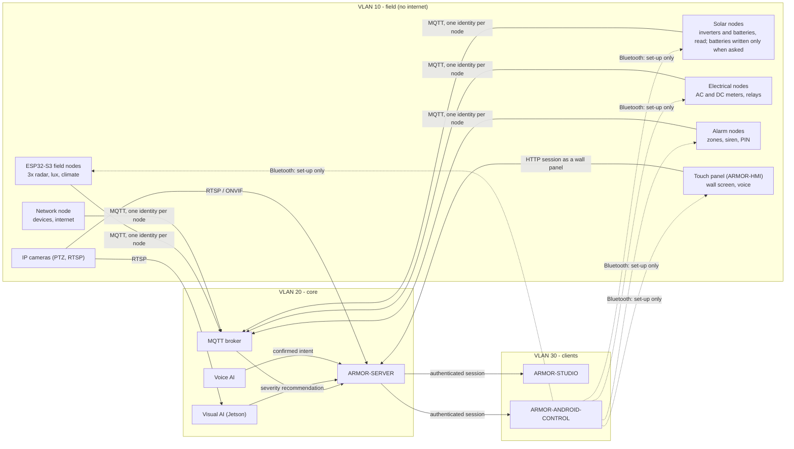

# A.R.M.O.R. architecture

## Trust boundaries

* **Field nodes** publish observations and health. Each has its own broker identity and can
  write only its own topics; the broker is the boundary, and the server validates every payload
  again against the published contract (dropping and counting a field it does not know, so that an
  old server keeps working with a newer node). A node never receives an instruction it can execute
  without an allow-listed command.
* **The server is the only place that touches a camera.** No client receives a camera password
  or an RTSP address. Clients get JSON, MJPEG and files through an HttpOnly session.
* **The AI services recommend, they never act.** The visual policy returns a severity with
  reasons and `authorizes_action = false`; the voice service returns an intent and needs a
  service-issued confirmation for arm and disarm. The server authenticates and authorises
  every action, and carries out a spoken or written command with the session of the person who gave it.
* **Studio and Android are clients of the server**, not of the field network. They never reach
  a node's own configuration endpoint. The one exception is the set-up of a node from the Android
  app over **Bluetooth Low Energy** (below), which needs no network at all.
* **Solar and electrical nodes read their equipment; the one thing they can write is a Pylontech
  battery's memory, and only when asked in three places.** They publish what their inverters,
  batteries and meters report; no request that writes to an inverter or a meter exists in their
  firmware. A battery can be written to (its clock, counters, limits, outputs, serial number and
  firmware) through typed operations that are off by default in the node, the server and the broker,
  that an administrator orders after proving who they are again and typing the battery's serial
  number, and that a node carries out in two steps (arm, then execute with a one-time token), reading
  the battery before and after. What a node can move besides is relays (off by default in three
  places) and, for a source-transfer switch, a channel that is off by default and needs a two-step
  command. See `ARMOR-SOLAR/docs/BATTERY_MAINTENANCE.md`.
* **A phone sets a node up over Bluetooth** (name, Wi-Fi, address, broker): the same channel on the
  radar, solar, electrical, alarm and touch-panel nodes. The link is encrypted with a PIN derived from
  the node's set-up code, every operation but `hello` needs the set-up code or a login, changing
  anything needs an administrator, and wrong passwords are throttled; see the
  [security baseline](SECURITY_BASELINE.md) for what that does not stop.

## Controlling the nodes

Studio and the phone can order a node, without opening its configurator, to `restart`, `pause`, `resume`, `standby`, `identify`, `diagnostics`, `maintenance_on` or `maintenance_off`: one node (`POST /api/v1/nodes/{id}/control`) or every node that reports (`POST /api/v1/nodes/control`, where a restart can be rolling), with the operations and the line of each node in `GET /api/v1/nodes/control/operations`. The contract is `node_control_command` and `node_control_result` in ARMOR-COMMON.

* **Topics.** The server publishes on `armor/control/<node>/command`, and on `armor/control/all/command` only the first step of an order; a node answers on `armor/control/<node>/result`. Nothing is retained. The broker's access list lets only the server write an order and every node read its own topic and the broadcast one.
* **Two steps.** The server sends `arm`; the node answers `armed` with a one-time token that belongs to that operation and lives thirty seconds; the server sends `execute` with the token. An execute for another operation, an expired, repeated or unknown token is refused with a typed reason and the token is spent.
* **The state of a node** is one of `running`, `paused` and `standby`, plus an independent maintenance flag. `pause` stops the node's work for 60 to 3600 seconds (an hour when none is said) and the work starts again by itself; a restart also ends it. `standby` is the node's work switched off *while it stays connected and keeps answering orders*: it has no end, it is kept across a restart (the node boots straight into it) and it ends only with `resume`. It is not a power-off. `maintenance_on` (60 to 28800 seconds) tells the server to hold back the alert that the node is silent; it does not change what the node does. `identify` makes the node show itself for 5 to 300 seconds, never with a siren. `diagnostics` answers a read-only snapshot. `restart` is the clean restart (the connections are closed first), at most one a minute for a node; a rolling restart gives every node a place so that nodes never restart in the same half minute and the alarm panels go last.
* **Refusals.** Restart, pause and standby are refused while the node installs a firmware, receives an upload, copies a slot or (the solar node) runs a battery operation; an order that leaves the node as it is, a repeated restart and an unknown or expired token are refused too, each with its own reason.
* **What each kind of node does while paused or on standby.** Radar: no targets and no presence are published (the heartbeat, the information message and the health report go on). Alarm panel: no zone is read, nothing is evaluated, armed or sounded, no state is published, the siren relay is held open and the server's commands are ignored; **the house is not protected** and the health report says so. Electrical: every relay is held open and none moves, whoever asks; the meters keep being read. Solar: every order to write a battery is refused (a running operation can still be cancelled) and the inverters and batteries keep being read. Wall panel: a screen of its own, which takes no touch, shows that the panel is paused or on standby; the link to the server keeps running.
* **What the server shows.** `GET /api/v1/node-health` carries the state, since when and by whom, how long a pause or maintenance has left, and whether the node said it or the server remembers it from its orders; Studio and the phone show it and warn before an order that leaves the house unprotected. A node in maintenance, or being restarted on order, does not raise the alert for its silence.
* **What it never does.** There is no factory reset, no erase of settings or Wi-Fi credentials, no deep sleep, no radio sleep and no wake timer, in the contract, the firmware, the server or the screens.

The rules are one piece of code shared by the five kinds of node and tested on a computer; the server's part is tested with a fake broker. None of it has run on a board.

## Time and ordering

Every message carries a millisecond timestamp: wall-clock time when the node's clock is set (SNTP), or the time since the node started when it is not, in which case the server stamps the
message with the time it received it (alarm events go as "seconds ago" for the same reason). The server ignores
a newer-than-received "online" message that is older than the last one it holds, always applies an
"offline" message (an MQTT last will cannot know the time of its own death) and never moves a node's
stored time backwards. A node that stops talking is shown *stale* and *offline* after a
configurable silence.

## Where each concern lives

| Concern | Project |
|---|---|
| What a message means | ARMOR-COMMON (JSON Schemas, conformance vectors, generated types, OpenAPI) |
| Sensing and field firmware | ARMOR-RADAR |
| Solar gateway nodes (inverters, batteries) | ARMOR-SOLAR |
| Electrical nodes (meters) and the rules for switching | ARMOR-ELECTRICAL |
| The alarm's zones, arming, delays, siren and PIN, with the server or without it | ARMOR-ALARM |
| The local network: devices, internet, changes | ARMOR-NETWORK |
| State, cameras, evidence, audit | ARMOR-SERVER |
| Visual and voice decisions | ARMOR-SERVER-AI, ARMOR-VOICE-AI |
| Operator consoles | ARMOR-STUDIO, ARMOR-ANDROID-CONTROL |
| The touch panel on the wall (state, arming, the voice assistant) | ARMOR-HMI |
| Enclosures and electronics | ARMOR-HARDWARE |
| Deployment | ARMOR-DEVOPS |
| Ecosystem-wide CI baseline and cross-machine install/update | ARMOR-COMMON, ARMOR-UPDATER |
| Offline testing and faults | ARMOR-SIMULATOR |

See the [capability matrix](CAPABILITY_MATRIX.md) for what is simulated, local or verified.
