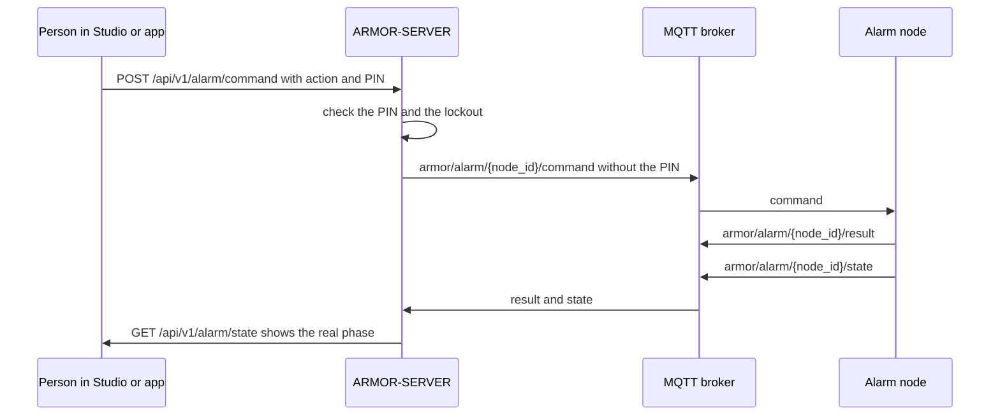
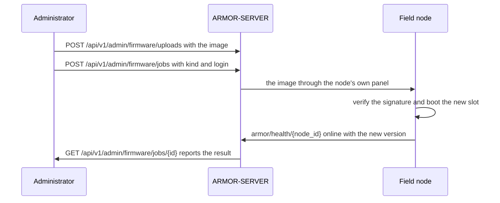
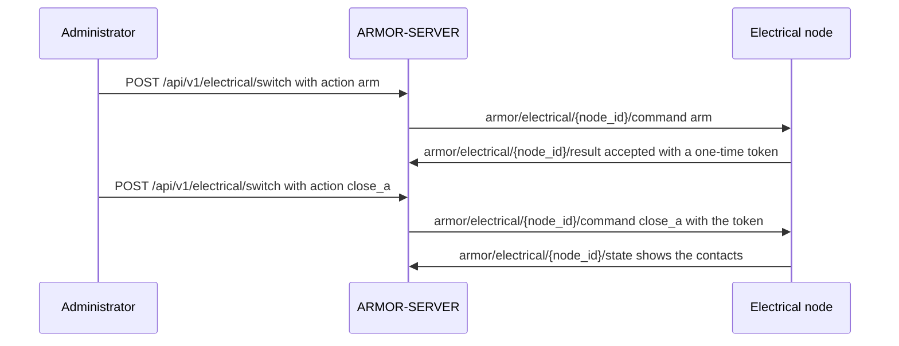
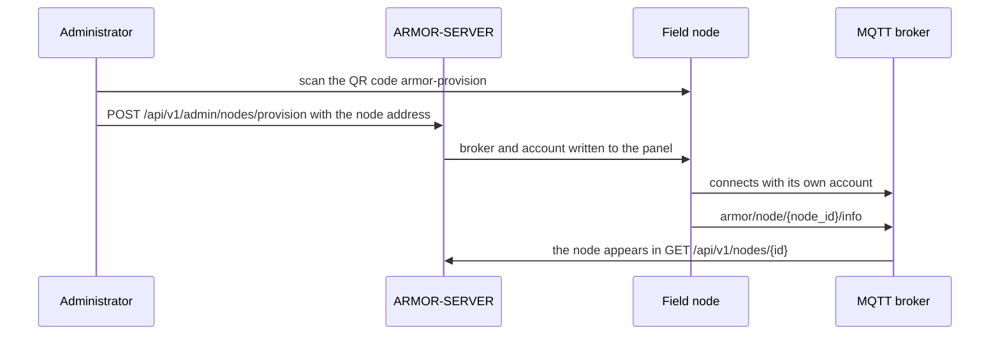

# Sequence diagrams of the critical flows

The four flows where a mistake costs the most, drawn from the contracts and checked against them: every route and every topic named below must exist in the OpenAPI file and the AsyncAPI document of ARMOR-COMMON (`python tools/check_sequences.py`, which the nightly family run executes). A route or topic that is renamed in the contracts makes the check fail until this page is updated.

## Arming and disarming with a PIN

The PIN of a disarm or a silence is checked by the server and never sent to the node; the node's own answer, not the 202, says whether the panel changed.

## A signed firmware update

The image is uploaded, the update job runs one node at a time, and the node accepts only an image signed by the key it trusts.

## Closing a switch in two steps

Closing is two commands: arm, then close once the node accepted the arm. The one-time token of the node stays on the server.

## Adding a node

The node is adopted in one step: the server makes its broker account and writes the broker address and that account into the node's own panel. The login used for that is used once and never kept.

